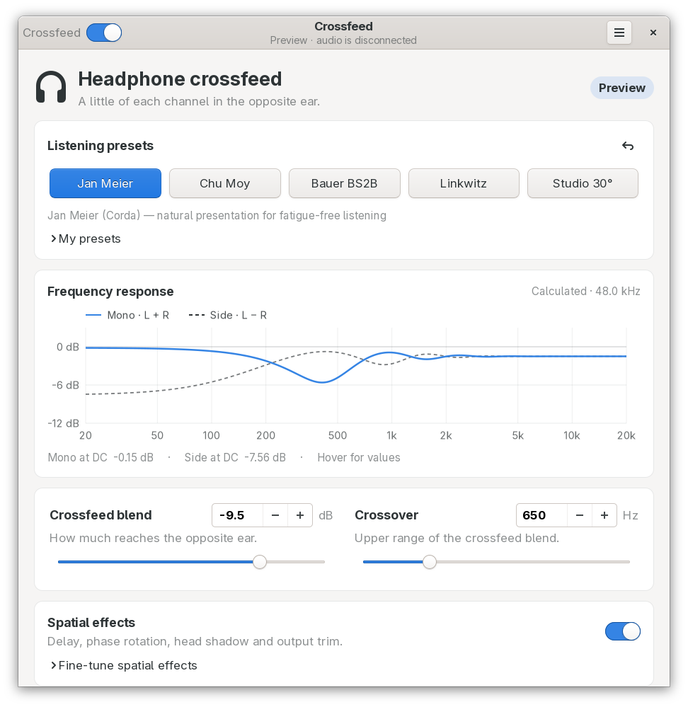
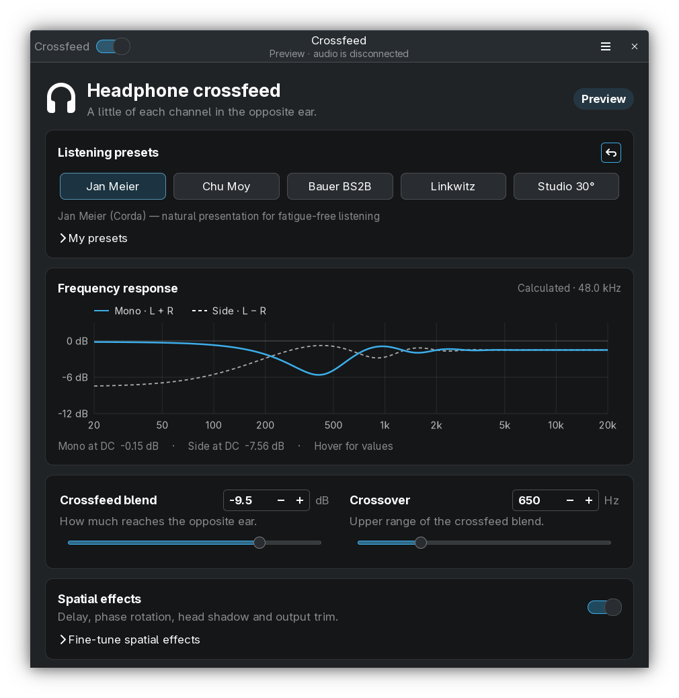
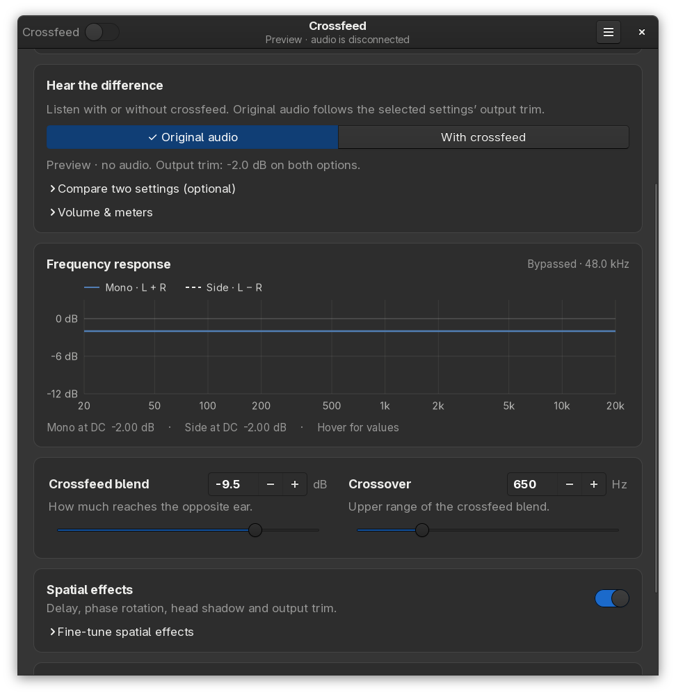

<div align="center">
  
  <h1>Crossfeed</h1>
  <p><strong>Headphone crossfeed for Linux, with a native GTK interface and an interactive response graph.</strong></p>
  <p>
    <a href="https://github.com/cecep-91/linux-crossfeed/releases/latest"></a>
    <a href="https://github.com/cecep-91/linux-crossfeed/actions/workflows/ci.yml"></a>
    
    
    <a href="LICENSE"></a>
  </p>
  <p><a href="#install">Install</a> · <a href="#using-the-gui">GUI</a> · <a href="#command-line">CLI</a> · <a href="#processing-and-presets">DSP and presets</a> · <a href="#development">Development</a></p>
</div>

Crossfeed blends a filtered portion of each stereo channel into the opposite ear, reducing extreme left/right separation in headphone listening. One C++17 executable provides the audio engine, GTK3 controls, tray menu, and CLI, with PipeWire, PulseAudio, and ALSA backends.

**Version 2.6.0** adds optional dry/A/B comparisons with shared output trim, saved user presets, and peak meters with a shared preamp. The comparison tools are hidden by default; enable **Menu → Show comparison tools** when you need them. See the [release notes](RELEASE_NOTES.md) or [download the release](https://github.com/cecep-91/linux-crossfeed/releases/tag/v2.6.0).

| Adwaita · light | Breeze · dark |
| --- | --- |
| [](data/screenshots/adwaita.png) | [](data/screenshots/breeze-dark.png) |

Actual screenshots in disconnected preview mode. The interface was checked with Adwaita and Breeze in light/dark variants, plus HighContrast. Fonts, controls, and colors follow the active GTK theme; KDE styling uses the installed Breeze GTK theme.

## Install

### Release packages

Download the package for your system from [GitHub Releases](https://github.com/cecep-91/linux-crossfeed/releases/latest). Release binaries are currently built for Linux **x86_64**. Run the appropriate command from the directory containing your download:

```sh
# Debian / Ubuntu
sudo apt install ./crossfeed_2.6.0-1_amd64.deb

# Fedora
sudo dnf install ./crossfeed-2.6.0-1.x86_64.rpm

# Void Linux: index the downloaded XBPS package as a local repository
xbps-rindex -a ./crossfeed-2.6.0_1.x86_64.xbps
sudo xbps-install -R . crossfeed
```

Packages install the binary under `/usr/bin`, along with a desktop launcher, icon, and license. On Fedora systems using rpm-ostree, the RPM can be layered with `rpm-ostree install ./crossfeed-2.6.0-1.x86_64.rpm`.

For a per-user installation, download and extract `pipewire-crossfeed-2.6.0-linux-x86_64.tar.gz`, then run `./install.sh` inside the extracted directory. It installs to `~/.local/bin` and `~/.local/share`; make sure `~/.local/bin` is on your shell's `PATH`. The user desktop launcher points directly to this installation, even if an older system package is also present.

The binary links to GTK3, Ayatana AppIndicator, and the audio-backend libraries; the tarball is not a static build. Native PipeWire routing also uses `pw-link` and `pactl`, including a reachable PulseAudio-compatible server to create the virtual sink.

### Build from source

You need a C++17 compiler, Make, pkg-config, and the development headers for the linked libraries.

| Distribution | Build dependencies |
| --- | --- |
| Void Linux | `sudo xbps-install -S base-devel pipewire-devel pulseaudio-devel alsa-lib-devel gtk+3-devel libayatana-appindicator-devel` |
| Debian / Ubuntu | `sudo apt install build-essential pkg-config libpipewire-0.3-dev libpulse-dev libasound2-dev libgtk-3-dev libayatana-appindicator3-dev` |
| Fedora | `sudo dnf install gcc-c++ make pkgconf-pkg-config pipewire-devel pulseaudio-libs-devel alsa-lib-devel gtk3-devel libayatana-appindicator-gtk3-devel` |
| Arch Linux | `sudo pacman -S --needed base-devel pipewire libpulse alsa-lib gtk3 libayatana-appindicator` |

```sh
git clone https://github.com/cecep-91/linux-crossfeed.git
cd linux-crossfeed
make -j"$(nproc)"
./install.sh
```

`./install.sh` performs a per-user installation without sudo. To remove it, run `./install.sh --uninstall` from a source checkout or extracted release. Saved preferences are preserved. For a system package, use your package manager to uninstall it.

## Quick start

```sh
crossfeed                   # Open the GUI; start the engine if needed
crossfeed gui --preview     # Explore the interface without touching audio
crossfeed preset meier      # Apply the Meier preset, or save it if stopped
crossfeed status            # Show engine settings and routing
```

Normal GUI/engine operation changes audio routing to feed the crossfeed processor. Preview mode starts no engine, contacts no engine IPC endpoint, creates no tray icon, and saves no settings. Its controls are interactive; close the preview window to exit. Before installing, use `./bin/crossfeed gui --preview` from the source directory.

## Using the GUI

- **Crossfeed switch:** turn crossfeed on or listen to the original audio. Controls remain available while crossfeed is off; the active output trim and shared output volume still apply.
- **Listening presets:** choose Jan Meier, Chu Moy, Bauer BS2B, Linkwitz, or Studio 30°. Expand **My presets** and choose **Save current…** to keep your settings or **Use preset** to recall them. **More…** contains rename, duplicate, delete, import, and export. The reset button restores the built-in filter defaults.
- **Optional comparison tools:** enable **Menu → Show comparison tools** to reveal the entire **Hear the difference** card, including Original audio / With crossfeed, A/B slots, output volume, and meters. It is hidden by default.
- **Frequency response:** see how the current settings affect mono and side signals. Hover for frequency and gain values.
- **Crossfeed blend and crossover:** adjust how much reaches the opposite ear and the upper range of that blend. Spin boxes provide numeric entry; double-click a slider to reset it.
- **Spatial effects:** turn on delay, phase rotation, head shadow, and output trim, or turn them off for Pure crossfeed. Expand **Fine-tune spatial effects** to adjust each stage.
- **Output and buffer/quantum:** inspect the selected device, backend, negotiated rate, and block size. Block duration is not total audio latency.

Presets wrap and tuning controls move into one column on smaller windows. Scrolling over sliders or spin boxes scrolls the view instead of changing their values.

### Compare with the same output trim

1. Open the app menu (☰) and enable **Show comparison tools**. The whole card is hidden by default; this display preference is remembered in `gui.ini` beside the engine settings. Preview mode keeps the choice temporary.
2. Choose **Original audio** or **With crossfeed**. Both use the selected preset's active output-trim gain: with −2 dB trim, original audio also gets −2 dB. There is no measurement or calibration wait.
3. To compare two presets or adjustments, expand **Compare two settings (optional)**. Configure the first and choose **Save current as A**, then configure the second and choose **Save current as B**. Use **Listen to A** and **Listen to B** to switch. Original audio follows the last selected setting's trim.



The same trim applies whether you select Original audio here or bypass using the header switch, shortcut, tray, or CLI. Advanced mode applies the configured output trim to both paths. Pure mode bypasses that trim stage on both paths. The additional **Output volume** preamp also applies equally to both. For example, −2 dB trim plus −3 dB preamp gives −5 dB total gain on the original audio. Ordinary changes and bypass transitions remain smoothed.

This copies the output gain setting; it does not measure or normalize perceived loudness. Crossfeed can still change the signal's energy because it blends and filters the channels. A/B slots retain their own trim settings and last for the engine session. Use **My presets** to keep settings between sessions. Showing or hiding the comparison card does not change playback.

Expand **Volume & meters** inside the optional card for **Output volume** and input/output sample-peak meters. Peak holds and clipping flags remain until **Clear peak readings**. Lower Output volume if the output clips. The meters do not measure inter-sample true peaks. For unscaled dry audio, set active output trim and Output volume to 0 dB (or use Pure mode with 0 dB Output volume).

User presets include filter settings and preamp, and are stored in `presets.crossfeed` beside `state.json`. Export writes the selected preset; import validates the complete file and gives duplicate names a suffix. The portable text format is versioned, limited to 128 presets and 64 KiB, and saved atomically. Preview-mode presets are temporary and import/export is disabled.

### Reading the graph

| Trace | Meaning |
| --- | --- |
| **Solid — Mono (L + R)** | Direct + crossfeed: the response to identical left and right inputs |
| **Dashed — Side (L − R)** | Direct − crossfeed: the response to opposite-polarity left and right inputs |

The graph is a **calculated steady-state filter response**, not a live spectrum analyzer. It updates with sliders, presets, effects mode, bypass, and reported sample rate. It uses the DSP's prepared coefficients and includes phase, the linear fractional delay, output trim and preamp. Dry audio displays a flat response at its applied gain; it is 0 dB only when no attenuation or preamp is applied. At lower sample rates, the graph stops below Nyquist.

The DC readouts describe only the response at zero frequency. A near-flat DC value does not imply a flat response across the audible band: the existing Meier advanced preset, for example, has a mono dip of roughly **−5.6 dB near 410 Hz at 48 kHz**. The graph makes this behavior visible; this release preserves the existing processed preset voicing.

### Keyboard and tray controls

| Shortcut | Action |
| --- | --- |
| `Ctrl+B` | Toggle bypass |
| `Ctrl+1` … `Ctrl+5` | Select a preset |
| `Ctrl+R` | Reset to defaults |
| `Esc` / `Ctrl+W` | Hide the normal GUI window; exit in preview mode |
| `Ctrl+Q` | Quit the GUI and request engine shutdown |

In normal mode, closing the window hides it while the engine continues running. Open Crossfeed again to show it. Where the desktop supports tray indicators, the tray menu also provides bypass, presets, effects mode, engine start/stop, and Quit.

## Command line

The same executable provides engine control without opening the GUI:

```sh
# Engine and status
crossfeed start
crossfeed status --json
crossfeed stop
crossfeed restart

# Bypass
crossfeed toggle
crossfeed on
crossfeed off

# Presets and tuning
crossfeed presets
crossfeed preset meier
crossfeed set --pure
crossfeed set --effects
crossfeed set --level -12 --freq 650 --delay 280 --phase 1500
crossfeed set --trim -1.5 --shadow 3200
crossfeed set --preamp -3
crossfeed preset "My preset"  # Exact name from the saved preset library

# Optional A/B listening (engine must be running)
crossfeed ab store a
crossfeed preset chumoy
crossfeed ab store b
crossfeed status --json      # Includes trim, A/B slots, and peak holds
crossfeed ab a
crossfeed ab b
crossfeed ab dry             # Follows the selected setting's active trim
crossfeed meters reset

# Offline computation benchmark and command reference
crossfeed bench
crossfeed help
```

To run in the foreground, stop any background engine first, then use `crossfeed run --backend pipewire`. Backend choices are `auto`, `pipewire`, `pulse`, and `alsa`. Use `--target` to select an output, `--rate` for the requested sample rate, and `--buffer` for the requested block size. PipeWire reports its negotiated rate and quantum.

Settings are saved under `$XDG_CONFIG_HOME/pipewire-crossfeed/state.json`, or `~/.config/pipewire-crossfeed/state.json` when `XDG_CONFIG_HOME` is unset.

## Processing and presets

Both modes process stereo float32 PCM:

| Mode | Direct path | Cross-ear path | Output trim |
| --- | --- | --- | --- |
| **Pure** | Low-shelf compensation | Q = 0.5 low-pass, then blend gain | Bypassed |
| **Spatial effects / Advanced** | Low-shelf compensation | Low-pass → head-shadow low-pass → all-pass → fractional delay → blend gain | Applied to the entire mix |

Left output combines the left direct path and right cross-ear path; right output combines the right direct path and left cross-ear path. Pure mode retains filter phase/group delay. The advanced delay control adds delay on top of that introduced by the filters. An all-pass has flat magnitude in isolation, but its phase changes the direct-plus-cross sum; it does not guarantee cancellation-free output. Output trim is not a limiter.

Preset names acknowledge familiar crossfeed designs; they do not establish circuit-equivalent emulation or calibrated speaker angles. Selecting a preset enables spatial effects.

| Preset / CLI ID | Blend | Crossover | Delay | All-pass | Trim | Shadow |
| --- | --- | --- | --- | --- | --- | --- |
| Jan Meier / `meier` | −9.5 dB | 650 Hz | 280 µs | 1500 Hz | −1.5 dB | 3200 Hz |
| Chu Moy / `chumoy` | −6.0 dB | 700 Hz | 260 µs | 2000 Hz | −2.0 dB | 2800 Hz |
| Bauer BS2B / `bs2b` | −4.5 dB | 700 Hz | 350 µs | 1200 Hz | −2.5 dB | 2500 Hz |
| Linkwitz / `linkwitz` | −7.0 dB | 1200 Hz | 220 µs | 1600 Hz | −1.8 dB | 4000 Hz |
| Studio 30° / `studio` | −8.0 dB | 850 Hz | 250 µs | 1800 Hz | −1.5 dB | 3500 Hz |

### Real-time behavior and limits

- Audio processing uses fixed storage and ownership-based parameter snapshots. Control writers may lock; the audio callback does not take that mutex or compute filter coefficients.
- Ordinary parameter, mode, and bypass changes crossfade over **20 ms**. Delay changes also ramp. Initial processing and explicit resets apply immediately.
- Supported rates are **8–192 kHz**. Cutoffs are capped at **45% of sample rate**, and non-finite control values are rejected.
- PipeWire prepares changed-rate coefficients on its control loop. Audio uses dry passthrough until a matching snapshot is available, then fades processing in. Clock changes can still be audible.
- Coefficients use double intermediates, with float storage and states. Processing scopes denormal handling on x86 SSE2 and AArch64; global `-ffast-math` is not used.
- Routing restoration is best effort. Removed devices/ports and simultaneous routing edits need care. PulseAudio's blocking simple API can delay shutdown until I/O returns.

See [the DSP implementation](src/dsp.cpp), [parameter ownership](src/dsp.hpp), and [the graph model](src/response.hpp) for details.

## Updating

For a per-user installation:

```sh
crossfeed check-update
crossfeed upgrade
```

The GUI's menu also has **Check for Updates…** and an upgrade action. The updater uses a source checkout when available, otherwise a release tarball, and installs under `~/.local`. It restarts an engine that was running; this can interrupt playback. Reopen the GUI after upgrading to use the new interface.

From a source checkout, `make update` or `./install.sh --update` runs the updater. For a package-managed installation, install the newer release package with your package manager to keep that installation under package-manager control.

## Development

```sh
make -j4
make test test-rt test-routing test-cli
make test-sanitize
make test-tsan
make bench

# GTK interaction checks on a private virtual display (requires Xvfb)
GTK_THEME=Adwaita xvfb-run -a make test-gui
GTK_THEME=Adwaita:dark xvfb-run -a make test-gui
```

| Check | Coverage |
| --- | --- |
| `make test` | DSP/IPC regressions, graph-model agreement, shared dry/processed output trim, preset serialization, peak holds, and concurrent telemetry |
| `make test-rt` | Instrumented processing checks for C++ allocations and pthread mutex locks |
| `make test-cli` | Saved user-preset recall and listening commands against an isolated fake engine |
| `make test-routing` | Native startup failure with fake routing commands and an isolated runtime directory |
| `make test-sanitize` | Address, undefined-behavior, float-cast-overflow, and leak checks |
| `make test-tsan` | DSP and IPC thread-race checks |
| `make test-gui` | Actual GTK controls in disconnected preview mode: switches, graph updates, presets, rate bounds, narrow layout, and stopped state |
| `make bench` | Offline callback computation time for steady input, decaying silence, parameter changes, A/B recalls, and bypass |

Listening tests verify that dry samples follow the active trim and shared preamp at 8–192 kHz, and that processed samples use the same trim multiplier. They cover Advanced/Pure modes, planar/interleaved processing, smoothed trim changes, A/B recall, rate fallback/recovery, graph agreement, clipping, preset storage, and concurrent control/telemetry. GUI tests verify the hidden-by-default menu option, preference persistence, preview isolation, and narrow layouts.

Core tests do not require GTK development headers. IPC tests require local Unix socket permissions; routing tests require Python 3 and the full application build. Sanitizer targets need the compiler's matching runtime/development packages. GTK tests require a display or Xvfb and write screenshots to `/tmp/crossfeed-gui-preview`. Other installed themes can be tested with `GTK_THEME=Breeze`, `GTK_THEME=Breeze-Dark`, or `GTK_THEME=HighContrast`.

CI runs the regression, sanitizer, and GTK light/dark checks, then exercises packages on Linux distributions. The graph and theme checks do not establish measured end-to-end latency, hotplug reliability, or subjective listening quality. Benchmark results describe computation time, not an xrun guarantee.

### Build packages

```sh
make deb       # Requires dpkg-deb
make rpm       # Requires rpmbuild
make xbps      # Requires xbps-create
make pkg       # All three; outputs are written to dist/
```

The [release workflow](.github/workflows/release.yml) builds Debian/RPM packages and a binary tarball on Ubuntu, and the XBPS package in a Void Linux container.

## Acknowledgments and license

Crossfeed draws inspiration from Meier, Moy, Bauer, and Linkwitz crossfeed designs, and uses biquad formulations associated with Robert Bristow-Johnson's Audio EQ Cookbook. Thanks to the PipeWire, PulseAudio, ALSA, GTK, and Ayatana communities for the underlying audio and desktop infrastructure.

Released under the [MIT License](LICENSE).
